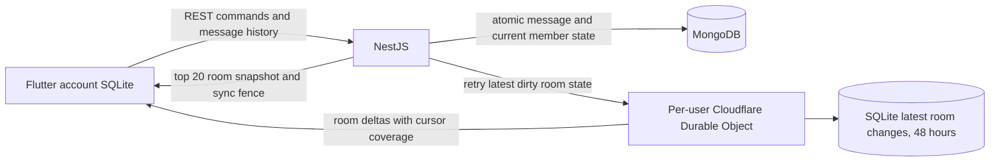

# Architecture: room state sync v2

The normative design is [Room sync v2](contracts/ROOM_SYNC_V2.md). This revision replaces the original retained MongoDB event journal and immutable message-event replay model.

MongoDB owns permanent messages, rooms, membership and per-user unread/read state. Cloudflare owns a disposable, recoverable delivery projection of the latest room changes. Flutter owns account-isolated caches, outgoing intents and the cursor committed before ACK. No Redis, D1, Socket.IO, production authentication or push service is involved.

A message transaction commits its canonical message, global room preview and each member's current room revision/unread change. A serialized relay publishes dirty current state after commit, and clears the dirty marker conditionally against the accepted revision. A crash or Cloudflare outage leaves one latest current state to retry per membership, not an accumulating queue of message events. Epoch/publication metadata detects replacement storage; it does not preserve event history.

The Durable Object is keyed by `(datasetId,userId)` and permits one current socket per device. Higher source revisions overwrite that room's retained payload and allocate a new delivery cursor. Independent devices receive immutable bounded batches through the same live/replay pump. Exact in-flight frame bytes survive object re-entry separately from mutable room projections. Retention expires payloads after 48 hours regardless of device ACKs, with alarm and access-time enforcement. Minimal highest-version metadata prevents stale retries reviving expired payloads.

Sparse room item sequences are intentional compaction. An explicit coverage range, epoch and replay floor distinguish a valid compacted delta from missing coverage. Unknown/expired/large gaps obtain an HTTP room snapshot. The first 20 rooms are ordered by activity with deterministic cursor pagination for older rooms. The API captures the Cloudflare cursor before the MongoDB snapshot to avoid losing a concurrent change.

Messages are fetched over HTTP in authoritative windows of 30, on room open/resume/reconnect and active-room invalidation. The client reconciles only the returned sequence interval; it cannot infer deletion of an older message from absence in a recent page. Verified display ranges prevent a large offline gap being shown as contiguous cached history. Outgoing message confirmation comes from POST/history, not a room preview.

Unread counts are per membership and exclude own sends. A read command advances only through displayed canonical messages and cannot move the cursor backward or erase later unread messages. Read changes publish to the same user's devices and do not reorder room activity or emit peer read receipts.

Presence remains ephemeral: hibernatable sockets use ping/pong, leases, periodic snapshots and cross-object notifications. Presence never controls message persistence, unread increments, publication or retention. No background socket keepalive is added.

Only the dedicated development Worker and local MongoDB demo database are authorized. MongoDB stays on loopback27028; LAN testing exposes only the authenticated development API. Original v1 verification remains historical evidence; use the v2 entry in [implementation status](IMPLEMENTATION_STATUS.md) for current checks and limitations.
